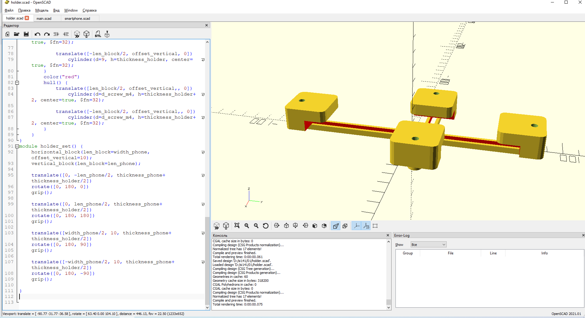

<<<<<<< HEAD
# Цифровой окуляр микроскопа 

Модель в формате OpenScad для печати на 3D-принтере. 

# Ссылки 
1. [Universal Phone Microsope Adapter] (https://www.thingiverse.com/thing:431168)проект в сервисе
thingivers
=======
# Цифровой окуляр микроскопа 

Модель в формате OpenScad для печати на 3D-принтере. 

# Ссылки 
1. [Universal Phone Microsope Adapter] (https://www.thingiverse.com/thing:431168)проект в сервисе
thingivers
>>>>>>> 3617128c82c3b364e52d8e5e5647889e83ce7548
