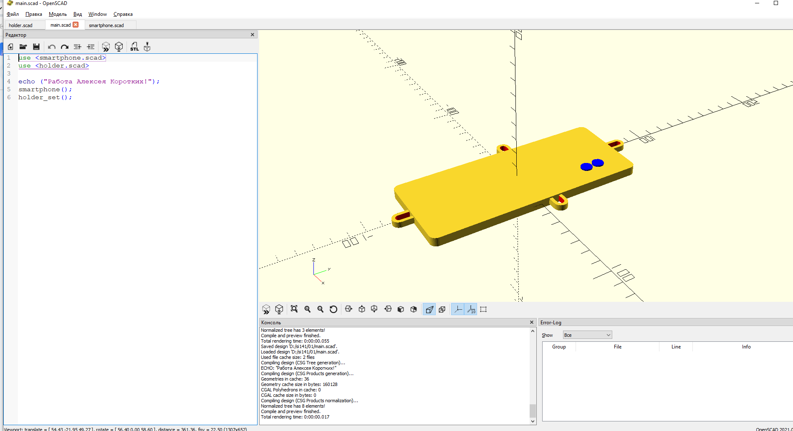

# Цифровой окуляр микроскопа 

Модель в формате OpenScad для печати на 3D-принтере. 

# Ссылки 
1. [Universal Phone Microsope Adapter] (https://www.thingiverse.com/thing:431168)проект в сервисе
thingivers
